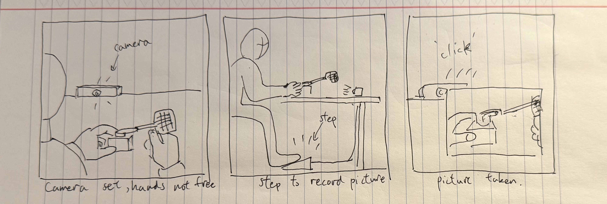
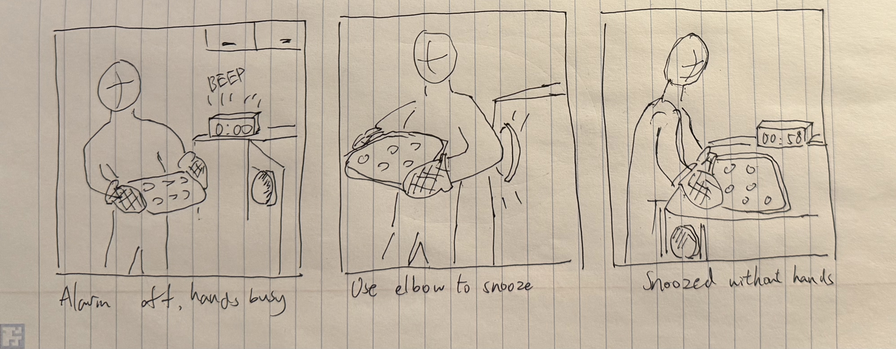

# Final Project Concepts

## Foot-operated workbench camera

A maker holding two prototype pieces in alignment presses a foot pedal to take a photo. A shutter sound confirms the shot so they know when they can let go. The aim is to capture how the pieces fit while both hands are still holding them in place.

### My use scenario and sketch

The photo I’d want for Fly Shoo is a close-up of where the paper paddle meets the plastic servo arm, just before I tape them together. Once the tape is on, it hides the overlap that someone trying to rebuild it would need to see.

1. I steady the servo with my left hand and line up the paddle with my right. The camera is clamped above the bench, aimed at the joint between my thumbs.
2. Keeping both pieces still, I press the pedal once with my toe.
3. The camera saves one photo and plays a shutter click. I can let go when I hear it.

### Connection to a lab

The Fly Shoo demo shows the paddle sweeping over a tissue box. To document how it was attached, I’d set the camera angle before picking up the parts. For a first test, I’d hand someone the pedal and the two loose pieces, then inspect their photo. Can I see the end of the plastic arm and how much paper overlaps it, or does a thumb cover the joint? [Lab 4 prototype documentation](../Lab%204/README.md#prototype-documentation)

## Elbow-operated kitchen timer

A cook carrying a tray can bump a large pad with their elbow when the kitchen timer rings. One possible response is a spoken “One more minute” before the timer rings again. A question to explore is when the cook wants another reminder and when they want to dismiss the alarm.

### My use scenario and sketch

Picture two batches of cookies. I’m carrying the first tray to the cooling rack when the timer tells me to check the second batch. I want a reminder after I’ve set the hot tray down.

1. I reach the counter with an oven mitt on each hand and the tray held level between them.
2. A broad pad sits on the side of the cabinet next to the cooling rack. I bump it once with my elbow while both mitts stay on the tray.
3. The ringing stops and the timer says “One more minute.” I set the tray down. A minute later it rings again, reminding me to check the oven.

### Connection to a lab

In the Fly Shoo test, our classmate suggested a remote button because the wires limited where the joystick could sit. I’d make the timer pad repositionable for the same reason. I’d start with a cardboard pad and a cold tray, and have someone walk from the oven to the rack. I’d mark where their elbow naturally passes, move the pad there, and try again. After the bump, I’d ask what they expect the timer to do next. That would tell me whether the one-minute reminder matches what they wanted. [Lab 4 user feedback](../Lab%204/README.md)
