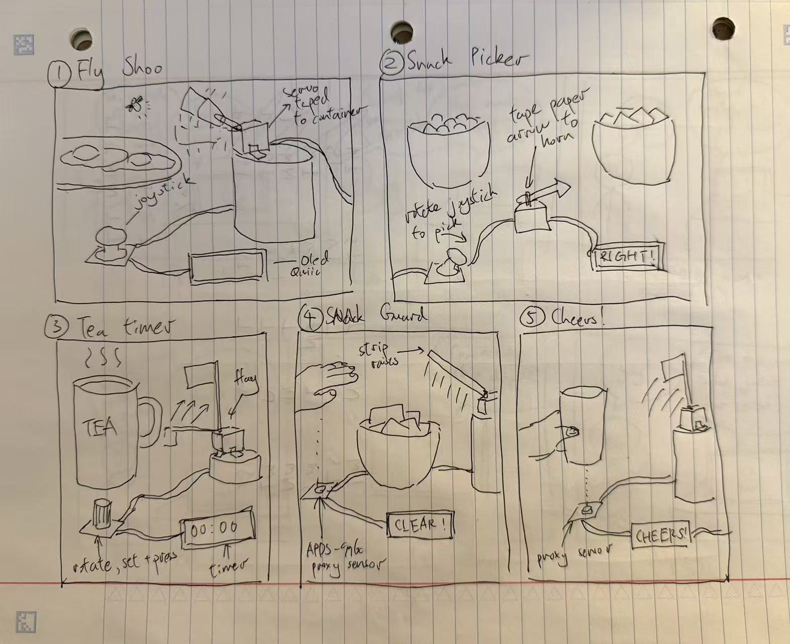
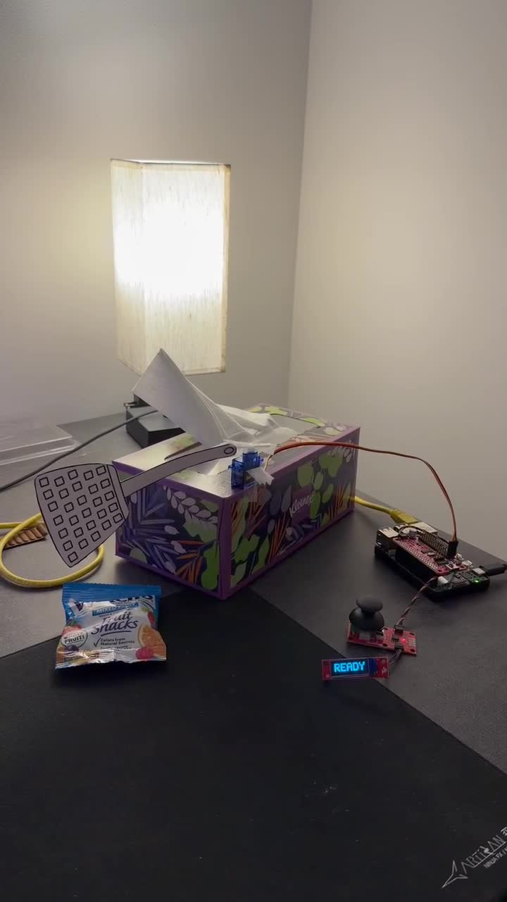
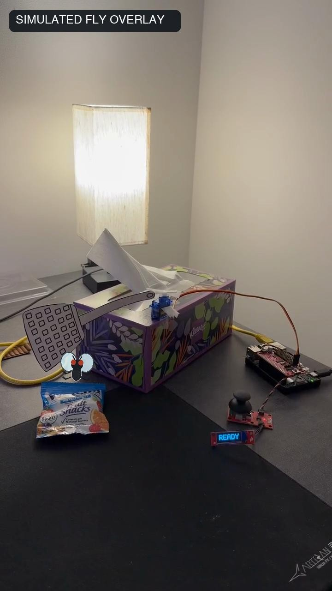

# Lab 4 — Fly Shoo

**Team:** Hong Yuan Cao (hc2343), Yun-Chung Liu (yl4445)  
**Project:** Fly Shoo — Feast Automata

Fly Shoo turns the familiar gesture of waving flies away from a meal into a button-controlled interaction. Press the joystick down, and a servo sweeps while a Qwiic OLED displays **SHOO**. The physical prototype uses a lightweight paper fly-swatter attachment on a servo mounted to a tissue box, beside a packet of fruit snacks.

### Part D
### Physical Interaction Design: Feast Automata — Fly Shoo

Our concept, **Fly Shoo**, turns the familiar action of waving a hand to chase flies away from food into a button-controlled physical interaction. Pressing the joystick's built-in button triggers a short servo sweep and changes the OLED display from **READY** to **SHOO**. The intended physical design uses a lightweight paper paddle attached to the servo arm beside a plate.

#### Five design sketches



We explored five arrangements using the kit's inputs, a servo, and a Qwiic OLED. 

| Concept | Input and physical response | Physical arrangement |
| --- | --- | --- |
| **1. Fly Shoo** | Press the joystick button to sweep a paper paddle; the OLED shows SHOO. | Servo mounted on a container beside a plate, with the joystick within reach and the display facing the user. |
| **2. Snack Picker** | Move the joystick to point a paper arrow toward one of two snacks; the OLED identifies the selection. | Servo and arrow sit between two bowls, with the joystick and screen in front. |
| **3. Tea Timer** | Turn the encoder to set a timer and press to start; a flag rises when time is up. | A servo-mounted flag sits beside the mug, while the OLED displays the countdown. |
| **4. Snack Guard** | A proximity sensor detects an approaching hand and the servo lifts a lightweight barrier. | The sensor faces the approach to the bowl; the servo sits beside it with space for the barrier to rise. |
| **5. Cheers** | Bringing a cup near a proximity sensor triggers a waving flag and a CHEERS message. | The sensor faces the cup's placement area, with the flag and display positioned beside it. |

#### Questions raised by the sketches

The sketches helped us identify physical questions that code alone cannot answer:

- **Mounting and stability:** Will tape hold the servo in place during repeated movement, or will the supporting container slide or tip? We need to test the mount with the moving attachment installed.
- **Attachment size and clearance:** How large can the paper paddle, flag, or arrow be before it bends, slips, or hits nearby objects? We need to try lightweight attachments and check their complete sweep.
- **Input placement:** Can the proximity sensors distinguish the intended cup or hand from surrounding objects? We need to compare readings with different placements. For Fly Shoo, we need to check that the joystick can be pressed comfortably without moving the assembly.
- **Display placement:** Can a seated user read the OLED while operating the device? We need to try screen angles and positions relative to the plate and joystick.
- **Effectiveness:** Does Fly Shoo's movement actually discourage flies? The prototype explores the interaction; fly deterrence still needs testing.

#### Why we chose Fly Shoo

We chose **Fly Shoo** because it gives a familiar dining gesture a playful physical response while keeping the build manageable. The joystick button provides a deliberate trigger, the servo makes the response visible, and the OLED tells the user when the device is active or ready. A paper paddle and a reused container let us explore the form without 3D printing or a complicated cardboard mechanism.

The white plastic servo arm connects the motor shaft to the paddle. Its center is secured to the shaft with the retaining screw, and the lightweight paper attachment can be taped to the arm. The servo body needs a separate stable mount so that the paddle moves rather than the whole motor. Our design places the mechanism beside the plate with enough clearance to avoid touching the food.

#### Rough prototype and interaction

[Our first Fly Shoo prototype video](assets/prototype_1.mp4)

This first prototype focuses on connecting the button, display feedback, and movement. The next physical checks are the paddle attachment, mounting stability, and clearance around a plate. We also need to assess whether the motion is useful for shooing flies rather than assuming the interaction alone proves that it works.

---

### Part E
#### Build and integrate: button, movement, and display

The electronic prototype combines a deliberate input with physical output: pressing the joystick button triggers a short sequence of servo movements and a matching screen message. The joystick and OLED share the I²C bus through Qwiic cables. The servo connects to channel 0 of the pHAT rather than to the Qwiic chain.

| Component | Role |
| --- | --- |
| Raspberry Pi | Runs the interaction program |
| SparkFun Servo pHAT | Drives the servo on channel 0 |
| Qwiic joystick | Its built-in button starts one movement cycle |
| Micro servo and plastic horn | Move the attached lightweight paddle |
| Qwiic OLED, 128 × 32 | Displays READY and SHOO |
| Paper fly-swatter attachment, tape, and tissue box | Provide the moving paddle and raised support beside the snack |

#### Interaction diagram

```text
Press joystick button -> Pi receives input -> OLED shows SHOO + servo sweeps
-> Servo returns to rest -> OLED shows READY
```

Physical connections:

```text
Pi + Servo pHAT — Qwiic cable → joystick → Qwiic OLED
               — channel 0: signal / 5V / GND → servo
```

```bash
source .venv/bin/activate
python fly_shoo.py
```

The program starts with the servo at a commanded 60° and the screen displaying **READY**. After the button has been released, a press triggers **SHOO** and three back-and-forth cycles between commanded positions of 30° and 90°, followed by a return to 60°. Position changes use small steps to produce a visible sweep. The screen then returns to **READY**. Holding the button does not repeatedly trigger movement; it must be released before another activation.

The servo's physical orientation depends on how the horn is installed, so the attachment's clearance needs checking on the actual assembly.

#### Development and reflection

One challenge was displaying text: the initial OLED text test failed because an external font file was missing. The demo now contains small bitmap letters for READY and SHOO, so those messages work without that file. Coordinating the message with the sweep also gives the user a clear indication of when a button press has been accepted.

The playful element is translating a familiar hand gesture into a small mechanical response. The remaining physical work is just as important as the electronics: the servo needs a stable support, the paddle needs to stay attached, and the sweep must clear the plate. Changing the support height, paddle length, or servo orientation changes where the movement happens even when the code stays the same.

Our first iteration established the button-to-display-and-servo interaction. The second iteration adds a paper fly-swatter attachment and a tissue-box support beside a packet of fruit snacks. The raw recording shows button presses, the READY/SHOO screen feedback, and the attachment changing position. Mounting the servo above the tabletop gives the attachment space to move, while the joystick and screen remain accessible in front.

#### User testing and feedback

We tested Fly Shoo with **Jovian (jlw457)**, a peer from our class. He found the interaction intuitive and easy to use, particularly because a single button press runs the entire sweep sequence without requiring the user to hold the button or control each movement.

His main suggestion was to make the controller remote. The current wires limit where the joystick can be placed relative to the device, making the physical arrangement less flexible. A remote controller would let the user keep the button within reach while placing the swatter closer to the food.

This feedback suggests that the simple trigger is worth keeping, while the placement of the controller needs more attention. We initially focused on making the button, screen, and servo work together; the test highlighted that an understandable interaction can still be inconvenient if its controls cannot be positioned comfortably.

For a future iteration, we would explore a wireless button while preserving the same one-press sweep and READY/SHOO feedback. We would then test whether a user can activate the device comfortably from their seat and still tell when the sweep has finished. Remote control is a proposed improvement, not part of the current prototype.

### Part F
#### Prototype documentation

| Aspect | Documentation |
| --- | --- |
| **Looks like** | The [five sketches](assets/sketches.jpg) explore the arrangement of input, screen, motor, and dining objects. The [raw final demo](assets/prototype_2.mp4) shows the paper attachment and tissue-box support. |
| **Works like** | The [raw final demo](assets/prototype_2.mp4) documents the physical response; [the code](fly_shoo.py) defines the button, screen, and servo sequence. |
| **Acts like** | A diner presses the joystick button, watches the SHOO message and paddle movement, and waits for READY before another activation. The raw final demo shows this interaction beside a packaged snack. |

#### Final prototype — raw recording

[](assets/prototype_2.mp4)

[Watch the raw video](assets/prototype_2.mp4). This unedited recording documents the actual assembly, button input, display, and servo movement. No fly has been added to this version.

#### Animated explanation — simulated fly

[](assets/prototype_2_animated.mp4)

[Watch the animated version](assets/prototype_2_animated.mp4). A computer-animated fly hovers near the snack and leaves in time with the SHOO activations. The original footage and audio are retained, with a persistent **SIMULATED FLY OVERLAY** label. This version illustrates the intended interaction; it is not evidence of a real fly being detected or repelled. The device responds to the joystick button, not to the animated fly.

The overlay was created with AI-assisted scripting; its fly is a drawn animation rather than generative video.
